# **PENETRATION TESTING REPORT** 

PASSWORD CRACKED 

W3-PM-1-2 | CYBERSECURITY |  NETWORKWALKS 

|**Pentester Name** **(Cybersecurity Professional)**|**Dheny Cahyono**|
|---|---|
|**Program/Batch**|B084-Networkwalks|
|**Date**|17 November 2026|
|**Modules completed**|W3-PM1 (PASSWORD CRACKING WITH JTR) W3-PM2 (PASSWORD CRACKING WITH NETWORKWALKS TOOLS)|
|**Tools**| https://networkwalks.com/hash-calculator/   https://networkwalks.com/password-cracker/   https://www.onlinehashcrack.com/tools-pdf-hash-extractor.php

----

## **1. Liability Disclaimer** 

I have performed these activities only on the systems & devices where I had secured written permission or the devices/systems that I own myself. All these materials are for education and research purpose only. Do not use anything from here to break the law. The instructor, the authors and Networkwalks are not responsible for what you do with this knowledge. Every action you take is your own responsibility. Misuse can lead to criminal charges, heavy fines, loss of your job and a permanent record. In most countries unauthorised access is a crime even when nothing is damaged. 

---

## **2. Introduction** 
**Password cracking** (also called password hacking) is an attack vector that involves hackers attempting to crack or determine a password for unauthorized authentication. Password hacking uses a variety of programmatic techniques, manual steps, and automation using specialized tools to compromise a password. These password cracking tools are referred to as ‘password crackers’. Increasingly, these tools are leveraging AI to improve password cracking speed and efficiency. Passwords can also be stolen via other tactics, such as by memory-scraping malware, shoulder surfing, third party breaches, and tools like Redline password stealer. (https://www.beyondtrust.com/blog/entry/password-cracking-101-attacks-defenses-explained)

**John the Ripper (JTR)** is a popular password cracking tool used by security professionals to test how strong
passwords are. It started as a tool for Unix systems but now works on Windows, Linux, and Mac. It can
check many types of password hashes and also unlock password protected files like PDF, ZIP, and Office
documents. (https://networkwalks.com : pdf resource)

----

## **3. Tools Used** 

The table below lists each tool used in this report and its purpose. 

|**Tool**|**Purpose**|
|---|---|
|Johny The Ripper (JTR) |password crack |
|pdf hash https://www.onlinehashcrack.com/tools-pdf-hash-extra|for upload pdf with ecrypt to get hash.|
|networkwalks.com  https://networkwalks.com/password-cracker/|for get password from hash Hash every word in a wordlist and match it against a PDF password hash, the same idea John the Ripper uses.|
|https://networkwalks.com/hash-calculator/ | Generate MD5, SHA-1, SHA-256, SHA-384, SHA-512, or extract a crackable hash from a password-protected PDF
----

## **4. Activities Password Cracker With Johny** 

### 1. goto https://www.onlinehashcrack.com/tools-pdf-hash-extra 
   
### 2. upload pdf with password (name my file pdf : My Locked PDF1)
   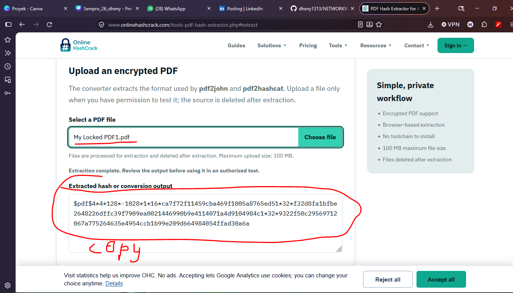

### 3. copy hash from hash generator and save it on note (i save notepade with name hash1.txt)
   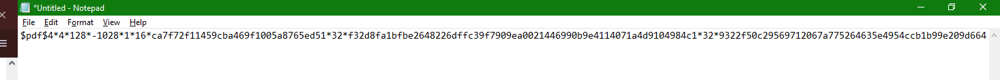

### 4. open johny and import note
   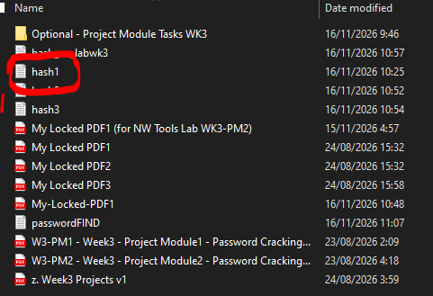
### select like this image (below)
   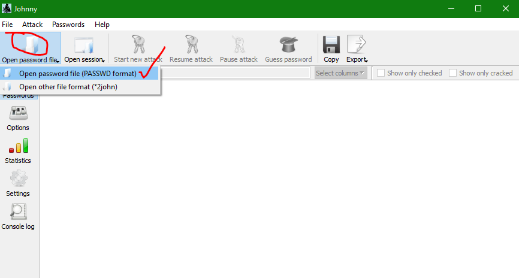

### 5. and klik "start new attack" (like image below)
   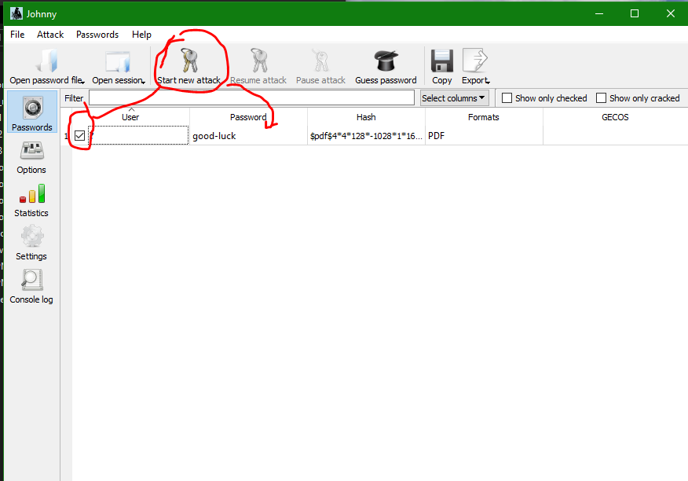

### 6. copy password result from Johny to open what is your hash pdf (name my file pdf : My Locked PDF1)
   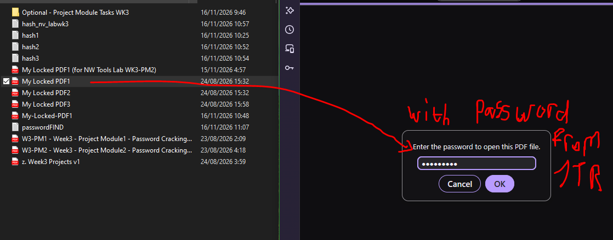

### 7. and magic
   

---
 

## **5. Password Crack with Networkwalks Tools** 

For the second activity, I used 
https://networkwalks.com/hash-calculator/ 

https://networkwalks.com/password-cracker/

### 1. open https://networkwalks.com/hash-calculator/ 
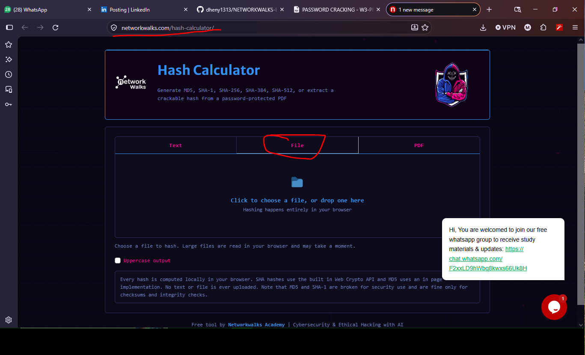

### 2. upload pdf and copy the result 
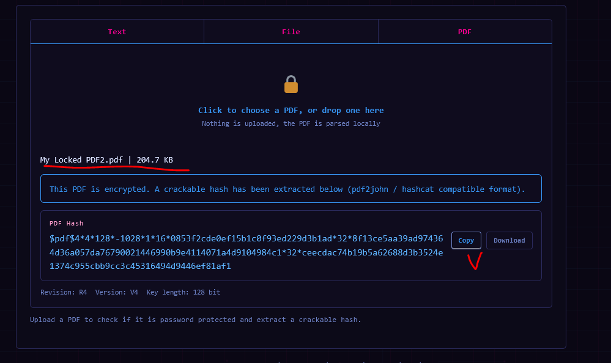

### 3.copy the result save as note (me save notepad file name : hash2.txt)
.PNG)

### 4.upload hash2.txt to Johny > klik "start new attack" and copy result password cracker to open pdf
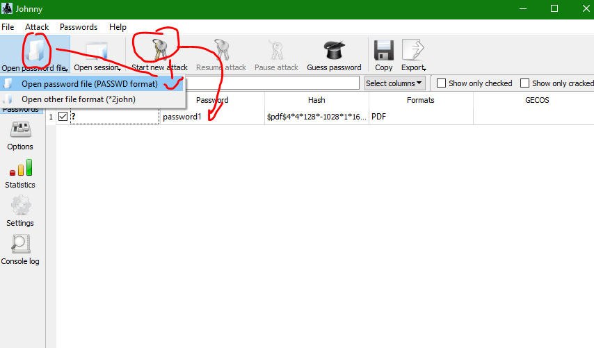

### 5. like this the flow
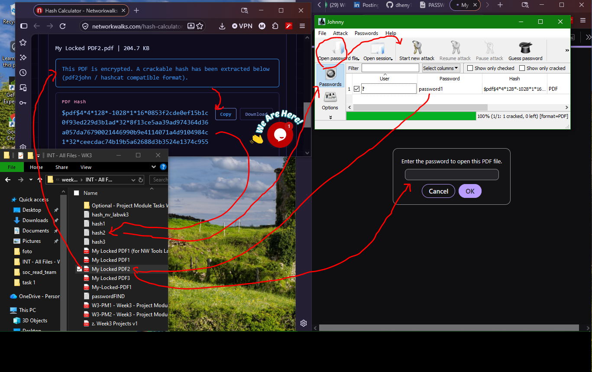

### 6. amazing

### 3A.1 open https://networkwalks.com/password-cracker/  (simple flow no JTR only networkwalks.com Tools, with wordlist they have)
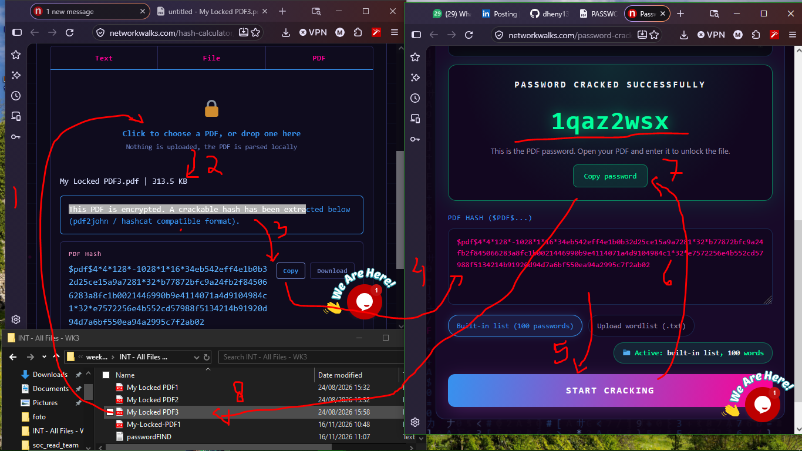

 

**👤 Author Dheny Cahyono** Intern Networkwalks B084 LinkedIn: https://www.linkedin.com/in/dheny-cahyono/ 

#### **👤 Project Information** 

**Program Name:** Cybersecurity program at Networkwalks | **Week:** 03 | **Repository:** GitHub 

Pentesting Project Report  |  Networkwalks  |  

